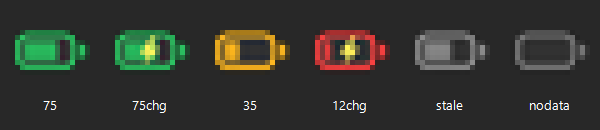

# BatteryTray — 外设电量托盘

Windows 托盘小工具:在任务栏实时显示无线外设(鼠标/键盘)的电量。单文件 C#,编译后约 44KB,零第三方依赖(只用系统自带 .NET Framework 4.x 与 Win32 API),运行内存约 30MB。



## 功能

- **托盘即电量**:图标为电池外形,颜色即电量(绿 >50 / 黄 20-50 / 红 ≤20 / 灰 = 全部休眠),充电时画黄色闪电
- **悬停**显示每台设备电量;**左键**弹出详情面板(名称 / 电量条 / 连接模式 / 状态 / HID 真实型号,再点一次收起)
- **低电量提醒**(≤20% 气泡,充电后自动复位)
- **休眠感知**:设备休眠时保留上次电量并标注,唤醒后 60 秒内自动刷新;真正拔掉 30 分钟后才从列表移除
- **右键菜单**:立即刷新 / 开机自启(计划任务,登录静默提权不弹 UAC) / 退出
- **添加设备**:面板右上角「＋添加」扫描向导,把内置表没有的设备存入 `devices.txt`;每行「✎」随时重命名(清空保存 = 恢复内置名)
- **蓝牙免添加**:自动读取系统缓存的蓝牙电池属性(`DEVPKEY_Bluetooth_Battery`)
- **日志**:`%LOCALAPPDATA%\BatteryTray\tray.log`,记录启动/退出/设备发现/唤醒/休眠/移除/低电提醒/异常,超过 256KB 自动清空

## 已验证设备

| 设备 | VID:PID | 协议 | 模式 |
|---|---|---|---|
| 迈从 K7 Ultra | `3837:1001` | RealTek A7(feature 0x11) | 2.4G |
| 迈从 2.4G 接收器 | `41E4:2004` | Compx G87(FF02 usage 2) | 2.4G |
| ATK 8K NANO 接收器 | `373B:11FE` | Nordic52(FF02) | 2.4G |

内置型号表(`src/BatteryTray.cs` 的 `InitModels`)另覆盖:ATK F1/A9/Zero、VXE R1、VGN F1/F2、迈从 A5/AX5/A7/L7/G87/G3/V7 等常见 VID:PID。其它采用 Compx/Nordic 芯片方案的外设(ATK/VXE/VGN/Dareu 部分型号)大概率可用「＋添加」向导直接接入。

## 编译

双击 `build.bat`,或手动:

```bat
%WINDIR%\Microsoft.NET\Framework64\v4.0.30319\csc.exe /nologo /optimize+ /platform:x64 /target:winexe ^
  /win32manifest:src\batterytray.manifest /out:BatteryTray.exe src\BatteryTray.cs ^
  /r:System.Windows.Forms.dll /r:System.Drawing.dll
```

csc 来自系统自带 .NET Framework 4.x,无需安装 SDK / NuGet / Node。

## 运行

- **需要管理员权限**:低完整性进程会被 Win11 的 UIPI 拒绝托盘注册(`Shell_NotifyIcon` 返回拒绝访问),这是系统限制,普通权限下图标不可见
- **开机自启**:托盘右键勾选;内部用 `schtasks /RL HIGHEST` 创建登录计划任务,静默提权不弹 UAC
- 命令行探测一次:`BatteryTray.exe --console`

## 配置 devices.txt

放在 exe 同目录(参考 `devices.txt.example`),每行 `VID:PID 名称`,支持 `#` 注释;手动改完下轮轮询(≤60 秒)自动生效。

## 目录结构

```
├── build.bat              一键编译
├── src/BatteryTray.cs     托盘主程序(单文件)
├── src/HidScan.cs         HID 全量扫描诊断工具(--all 探测各协议)
├── src/batterytray.manifest
├── scripts/               部署/诊断辅助脚本(热替换、状态检查、图标预览)
├── assets/                图标预览图
├── devices.txt.example    自定义设备配置模板
└── debug/                 开发期调试产物(已 gitignore)
```

## 工作原理

每 60 秒轮询一次(插拔设备时即时触发):枚举 HID 接口 → 按 VID/usage 页匹配协议族 → 发厂商电量查询帧解析应答;蓝牙设备直接读系统缓存属性。支持的协议族:

- **RealTek A7**:feature 0x11,应答逐字节 XOR 0xFF
- **Compx G87**:写 `13 4A 01`,应答 `r[5]`=电量
- **Nordic52**(ATK/VXE/VGN):17 字节帧,校验和 0x55
- **Nordic54**(ATK Zero):64 字节帧
- **蓝牙**:`DEVPKEY_Bluetooth_Battery`

## 已知限制

- 迈从 G98 V2(`41E4:2203`)协议未破解
- K7 Ultra 不上报充电状态
- 2.4G 接收器硬件不暴露配对设备型号,面板显示接收器自身产品名(可 ✎ 重命名)

## License

[MIT](LICENSE)
